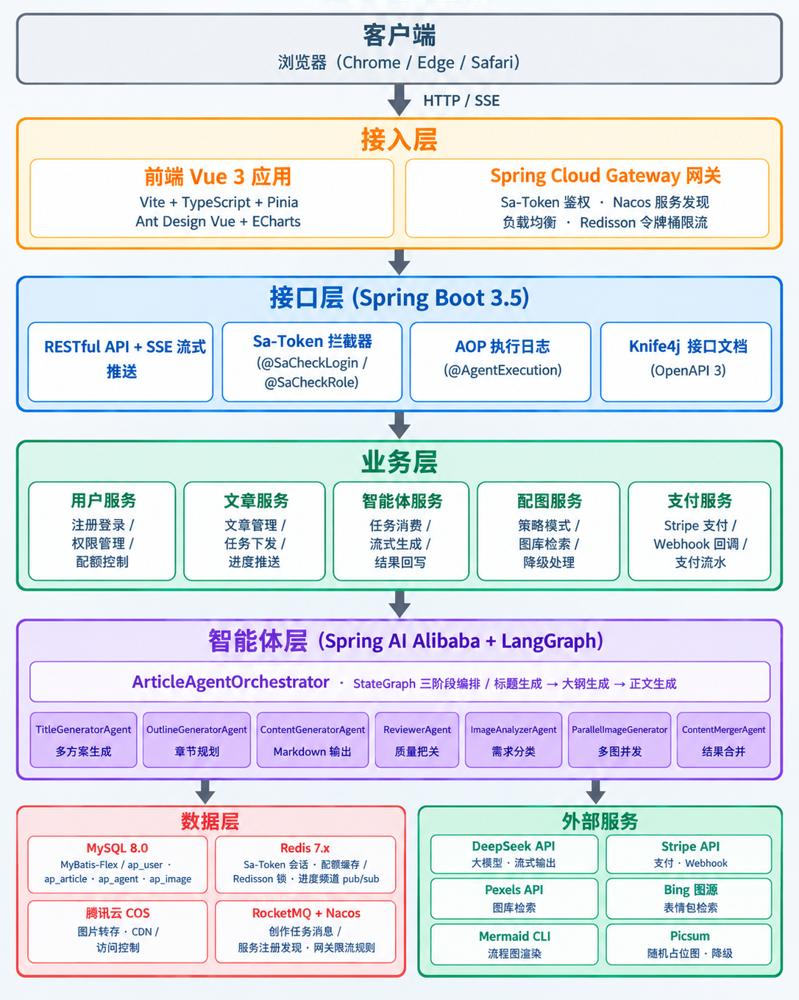

# AI Passage 

基于 **Spring Boot 3 + Spring AI Alibaba** 的多智能体协作图文创作平台。用户输入选题后，由 5 个 AI Agent 自动完成「标题生成 → 大纲设计 → 正文创作 → 配图分析 → 图文合并」的完整创作流程，支持 SSE 流式实时输出，让用户全程可见 AI 的创作过程。

## 项目预览

### 首页

<!-- 截图：首页整体界面，展示导航栏、Banner、功能入口等 -->


### 文章创作 — 输入选题

<!-- 截图：文章创建页面，展示选题输入框、风格选择、配图方式勾选等 -->


### 阶段一：AI 生成标题方案

<!-- 截图：标题生成完成后的界面，展示 3-5 个标题选项（含主标题+副标题），用户可选择一个 -->


### 阶段二：AI 生成大纲 + 用户编辑

<!-- 截图：大纲编辑界面，左侧展示 AI 生成的文章大纲（章节+要点），右侧支持手动编辑或输入修改建议让 AI 辅助修改 -->


### 阶段三：正文创作 + 实时流式输出

<!-- 截图：正文生成界面，展示 SSE 实时流式输出的 Markdown 内容，右侧或底部显示 AI 的思考过程/日志 -->


### 配图生成

<!-- 截图：配图生成过程界面，展示各章节配图的生成进度，可看到不同来源（Pexels、Mermaid 图表、AI 生图等）的并行生成状态 -->


### 文章详情 — 图文合并最终效果

<!-- 截图：文章详情页，展示图文合并后的完整文章，包含封面图、正文配图、Mermaid 图表、Emoji 装饰等 -->


### 文章管理列表

<!-- 截图：文章列表页，展示分页列表、状态筛选（待处理/生成中/已完成/失败）、操作按钮等 -->


### 管理后台 — 用户管理

<!-- 截图：管理员用户管理页面，展示用户列表、角色管理、分页等 -->


---

## 系统架构


<!-- 截图：系统架构图，展示 Vue3 前端 → Spring Boot 后端 → StateGraph 多智能体 → AI DashScope，以及 Redis/MySQL/COS 等基础设施 -->


```
浏览器 (Vue3)
    │
    ▼
aipassage-gateway :8090
  · Sa-Token 统一鉴权（Redis 共享）
  · RateLimitFilter（Redisson RRateLimiter 令牌桶）
  · Sentinel 流控（规则存 Nacos）
  · 路由转发到 user / article 服务
    │
    ├─► aipassage-user    :8411   登录注册 / 用户管理 / 配额 / Stripe 支付     [ap_user]
    ├─► aipassage-article :8421   任务状态机 / SSE 推送 / 统计                 [ap_article]
    │       │
    │       │  RocketMQ Topic=AIPASSAGE_TASK（标题/大纲/正文三阶段任务）
    │       │  Redis pub/sub aipassage:progress（流式进度事件）
    │       │  OpenFeign /internal/**（same-token 防护）
    │       ▼
    ├─► aipassage-ai      :8431   StateGraph 多智能体编排 / 任务消费 / 进度发布 [ap_agent]
    └─► aipassage-image   :8441   图源策略 / 两级缓存 / COS 转存              [ap_image]
                                        （ai / image 不暴露到网关，仅内部调用）

基础设施：MySQL 8 / Redis 7 / Nacos 2.4 / RocketMQ 5.3
```

### 多智能体流水线

```
用户输入选题
    │
    ▼
┌────────────────────────────┐
│  阶段1：标题生成            │  TitleGeneratorAgent
│  StateGraph: START → title_generator → END
└────────────────────────────┘
    │ 用户选择标题（confirm-title）
    ▼
┌────────────────────────────┐
│  阶段2：大纲生成            │  OutlineGeneratorAgent
│  StateGraph: START → outline_generator → END
└────────────────────────────┘
    │ 用户确认/修改大纲（confirm-outline）
    ▼
┌────────────────────────────────────────────────┐
│  阶段3：正文创作 + 配图                          │
│  ContentGeneratorAgent                         │
│      │ reviewEnabled=true 时                    │
│      ▼                                         │
│  ReviewerAgent                                 │
│   ├─ pass    → image_analyzer                   │
│   ├─ retry   → ContentRewriteAgent → reviewer   │
│   └─ giveup  → 超过 max-round 强制放行           │
│      ▼                                         │
│  ImageAnalyzerAgent（配图需求分析）               │
│      ▼                                         │
│  ParallelImageGenerator（CompletableFuture 并行）│
│      ▼                                         │
│  ContentMergerAgent（图文合并）                  │
│      ▼                                         │
│  END                                           │
└────────────────────────────────────────────────┘
    │
    ▼
  完整文章（图文并茂）
```
## 服务间协作机制

| 通道 | 方向 | 用途 |
|---|---|---|
| RocketMQ Topic `AIPASSAGE_TASK` | article → ai | 投递 TITLE/OUTLINE/CONTENT 三阶段任务消息，`maxReconsumeTimes=3` |
| Redis pub/sub `aipassage:progress` | ai → article | Agent 流式进度事件，article 转发给对应 SSE 连接 |
| OpenFeign + same-token（`SA-SAME-TOKEN` 头） | article ↔ user / ai ↔ article / ai ↔ image | 配额扣减/退还（taskId 幂等）、上下文获取、结果回写、失败上报 |

认证：user 服务登录签发 Sa-Token 令牌（存于共享 Redis），网关 `SaReactorFilter` 统一校验；各服务用 `@SaCheckRole` 做角色控制，`LoginUserHolder` 读取当前用户。`/api/internal/**` 内部接口不经过网关路由，且被 `InternalAuthFilter` 的 same-token 校验保护。


## 技术亮点

- **StateGraph 多智能体编排**：使用 Spring AI Alibaba StateGraph 构建工作流，通过 `ReplaceStrategy` 管理状态流转，实现 Agent 串行与并行协同
- **SSE 流式输出**：基于 Server-Sent Events 实现文章生成全过程的实时推送，用户可实时看到 AI 创作内容
- **ThreadLocal SSE 透传**：通过 `StreamHandlerContext` 将 SSE 处理器透传至 Agent 内部，避免序列化问题
- **策略模式图片服务**：统一封装 Pexels 图库、Mermaid 图表、SVG 图表、Iconify 图标、Emoji 表情包等图片来源，支持自动降级
- **Redis + MySQL 两级缓存**：L1 Redis+ L2 MySQL 持久化，细粒度缓存键去重，命中次数异步更新
- **并行配图生成**：基于 CompletableFuture 按图片类型分组并行执行，CopyOnWriteArrayList 保证线程安全
- **异步任务驱动的流水线**：article 与 ai 以 RocketMQ 解耦，阶段化任务由 ai 消费执行
- **内部接口 same-token 防护**： 为每次 Feign 调用附加 Sa-Token same-token，`InternalAuthFilter` 拦截 `/internal/*` 并校验，杜绝外部直接访问 ai/image 服务


## 技术栈

| 层级 | 技术                                                             |
|------|----------------------------------------------------------------|
| 后端框架 | Spring Boot 3.5、Java 21                                        |
| 微服务 | Spring Cloud Gateway、Nacos 服务注册、OpenFeign、Sentinel（Nacos 动态规则） |
| AI 编排 | Spring AI Alibaba StateGraph、Spring AI DeepSeek                |
| 消息队列 | RocketMQ 5.3（任务管道）、Redis pub/sub（进度事件）                         |
| ORM | MyBatis-Flex                                                   |
| 数据库 | MySQL 8.0                                                      |
| 缓存 | Redis（Sa-Token 会话 / 配额幂等键 / 图片 L1 缓存 / 进度 pub/sub）             |
| 对象存储 | 腾讯云 COS                                                        |
| AI 模型 | DeepSeek（正文/标题/大纲/SVG 生成）                                      |
| 支付 | Stripe Checkout Session + Webhook                              |
| 前端 | Vue 3 + TypeScript + Vite                                      |
| UI 框架 | Ant Design Vue                                                 |
| 状态管理 | Pinia                                                          |
| 实时通信 | SSE                                                            |

## 项目结构

```
aipassage/
├── aipassage-common/                # 公共模块（Feign 客户端 / 消息常量 / 异常 / 鉴权工具）
├── aipassage-gateway/               # API 网关（Sa-Token 鉴权 + Redisson 限流 + Sentinel + 路由）
├── aipassage-user/                  # 用户服务：注册/登录/用户管理/配额/Stripe 支付
├── aipassage-article/               # 文章服务：任务状态机 + SSE 推送 + 统计
├── aipassage-ai/                    # AI 服务：StateGraph 多智能体编排 + 任务消费 + 进度发布
├── aipassage-image/                 # 图片服务：图源策略 + 两级缓存 + COS 转存
├── frontend/aiPassage/              # Vue3 前端
│   ├── src/pages/                   # 页面组件
│   │   ├── article/                 # 创作/列表/详情（含标题选择、大纲编辑阶段）
│   │   ├── user/                    # 登录/注册
│   │   ├── admin/                   # 管理后台（用户管理、数据统计）
│   │   └── vip/                     # 会员中心（Stripe 购买/退款）
│   ├── src/components/              # 通用组件
│   ├── src/router/                  # 路由配置
│   ├── src/stores/                  # Pinia 状态管理
│   ├── src/api/                     # API 接口封装（OpenAPI 生成）
│   └── src/utils/sse.ts             # SSE 连接管理工具
├── docs/                            # 架构文档 / ai约束
└── pom.xml                          # Maven 父工程（多模块聚合）
```

## 快速开始

### 环境要求

- JDK 21+
- Maven 3.9+（或使用 `./mvnw`）
- Node.js 20.19+ / 22.12+
- Docker & Docker Compose（MySQL / Redis / Nacos / RocketMQ）

### 后端启动

```bash
./mvnw -pl aipassage-user    spring-boot:run
./mvnw -pl aipassage-article spring-boot:run
./mvnw -pl aipassage-ai      spring-boot:run
./mvnw -pl aipassage-image   spring-boot:run
./mvnw -pl aipassage-gateway spring-boot:run
```

### 前端启动

```bash
cd frontend/aiPassage

# 安装依赖
npm install

# 启动开发服务器（默认代理到 localhost:8341）
npm run dev
```

访问 http://localhost:5173 即可使用。

## 功能清单

- [x] 用户注册 / 登录
- [x] AI 自动生成多个标题方案供用户选择
- [x] AI 自动生成文章大纲，支持手动编辑 + AI 辅助修改
- [x] SSE 流式输出正文，实时展示 AI 创作过程
- [x] 内容审核（不合格自动重写再审，超轮次强制放行）
- [x] 多来源智能配图（Pexels 图库 / Mermaid 流程图 / SVG 概念示意图 / 表情包 / Picsum 降级）
- [x] 图文自动合并，占位符替换
- [x] 图片两级缓存（Redis L1 + MySQL L2），加速重复查询
- [x] 文章列表、详情查看、删除
- [x] 管理员用户管理
- [x] 管理员数据统计（今日/本周/本月创作数、用户侧统计）
- [x] Stripe 会员开通与退款
- [x] VIP 用户创作配额无限次
- [x] Agent 执行日志记录与监控

## 实例文章
